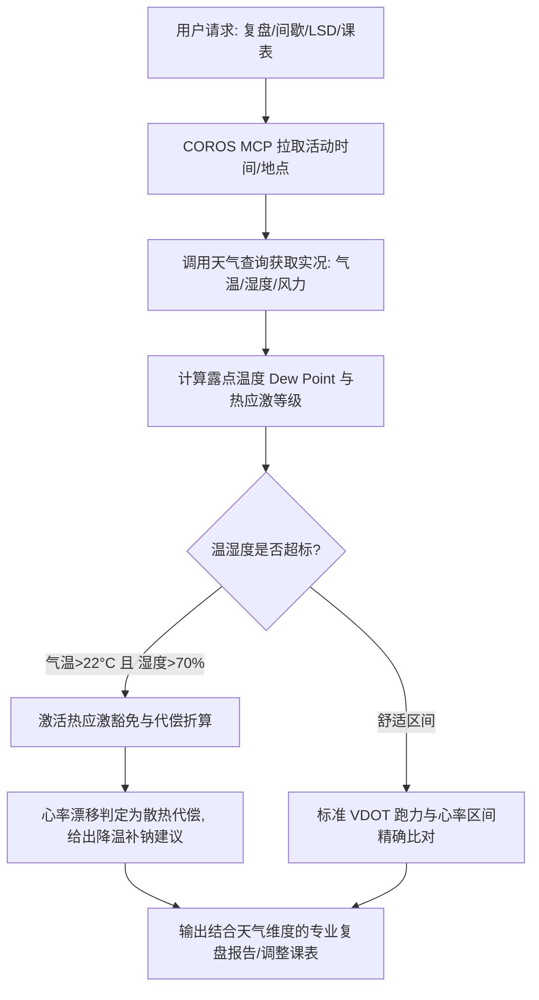

# 运动生理学：实时天气与温湿度配速折算标准

> 本文档为跑步教练的核心环境感知与生理折算参考。在复盘单次训练或排定未来课表时，必须结合气象数据进行客观归因与科学动态调整。

---

## 1. 为什么“露点温度（Dew Point）”是耐力运动的黄金气象指标？

在跑步运动中，**人体产生的能量约有 75%-80% 以热量形式耗散**。为了维持核心体温稳定，机体主要依赖**汗液蒸发**来散热。

- **单纯看气温会产生误判**：25°C、相对湿度 30%（干燥）与 25°C、相对湿度 85%（桑拿天）对人体的生理压力完全是两个世界。
- **露点温度的生理本质**：露点温度直接反映了空气中的绝对含水量。当露点温度升高时，皮肤表面的水汽压与空气中的水汽压差急剧缩小，**汗液无法蒸发散热（只能滴落）**。
- **心血管应激机制（心血管漂移 Cardiac Drift）**：
  为强行散热，交感神经兴奋，外周皮肤血管极度舒张，大量血液被分流至皮下毛细血管网；这导致**有效循环血量和回心血量显著减少，心室充盈不足，每搏输出量（Stroke Volume, SV）下降**。为了维持必要的心输出量（Cardiac Output），**心脏必须代偿性加快跳动**。
  
> **核心铁律**：**同等配速下心率偏高 5-10+ bpm，是人体为了散热活命而进行的正常生理代偿，绝不能机械误判为“有氧能力衰退”或“跑力退步”！**

---

## 2. 露点温度（Dew Point）对心率与配速的影响折算梯度

根据运动生理学经验模型（Daniels Formula & McMillan Heat Adaptation）：

| 露点温度 (°C) | 体感级别 | 相对配速损失 (%) | 典型配速调整 (秒/km) | 同等配速下心率代偿增加 | 训练/比赛执行建议 |
|---|---|---|---|---|---|
| **< 10°C** | 极佳舒适 | 0% | 0 | 0 bpm | 破 PB 理想黄金天气，心率与配速完全遵循 VDOT 标准标定值 |
| **10°C - 15°C** | 适度清爽 | 0% - 1% | 0 - 3 s/km | 0 - 3 bpm | 状态正常，常规训练与长距离无须刻意降速，注意常规补水 |
| **15°C - 18°C** | 略感闷热 | 1% - 3% | +3 - 8 s/km | +3 - 6 bpm | 出汗量显著增加；有氧 E 跑心率允许微升 3-5 bpm，或配速放慢 5 秒 |
| **18°C - 21°C** | 闷热潮湿 | 3% - 5% | **+8 - 15 s/km** | **+5 - 10 bpm** | **热应激显著！** T/M 配速需下调 8-15 秒/km；强制补充电解质 |
| **> 21°C** | 极度闷热 (危险) | 6% - 12%+ | **+15 - 30+ s/km** | **+10 - 18+ bpm** | **热射病高危！** 严禁执行极限 VO2max 长组间歇；长距离大幅缩短或移至室内跑步机 |

---

## 3. 气温与相对湿度综合判据（典型“桑拿天”诊断规则）

若气象数据未直接提供露点温度，采用以下气温与湿度联合判据：

### 关键诊断阈值：【气温 > 22°C 且相对湿度 > 70%】

当满足该条件（或气温 > 28°C 无论湿度）时，触发以下自动诊断逻辑：

1. **心率偏高豁免判定**：
   - 若用户在平时 5:30/km 的 E 跑配速下，心率由平常的 135 bpm 飘升至 144 bpm（偏高约 9 bpm）：
   - **教练裁决**：判定为**“典型高温高湿散热代偿”**，明确告知用户：“这是心血管在全力排热，你的有氧基础完好无损，请彻底放下对心率数字的焦虑！”
2. **后半程心率上漂（Cardiac Drift）豁免**：
   - 跑步超过 40 分钟后，若配速稳定但心率逐公里上升 1-2 bpm，且无明显肌肉脱力：归因于脱水与核心体温攀升引起的心血管漂移，不属于体能不足。

---

## 4. 高温天气排课与课表动态修正规范

在遇到高温高湿天气时，教练必须在生成或调整课表时主动实行“减负保命”策略：

### ① 配速基准自动下调
- **E 跑（轻松跑）**：以心率上限封顶（严格压制在 Z2 天花板以下），配速随缘下调 15-30 秒/km，允许跑走结合；
- **M 跑（马拉松目标配速）**：目标配速放宽下调 5-10 秒/km；
- **T 跑（阈值节奏跑）**：配速下调 5-15 秒/km，或者将单段持续 20-30 分钟拆分为“巡航间歇”（如 4×2km，组间休息 90-120 秒）。
- **I 跑（间歇跑）**：组数减少 20%-30%，每组间歇休息时间延长 30%-50%（确保心率回落至 120-130 bpm 再开下一组）。

### ② 强制补水与电解质指引
- **起跑前 2 小时**：摄入 400-500 ml 电解质水；
- **跑动中**：
  - 每 15-20 分钟补水 150-200 ml；
  - 运动 > 45 分钟或气温 > 24°C，必须添加电解质泡腾片/盐丸（钠含量 500-700 mg/小时），严禁只喝纯净水（防低钠血症/水中毒）；
- **起跑时间建议**：主动提醒用户改在清晨（日出前）或傍晚日落后起跑，避开阳光直射（辐射热）。

---

## 5. 低温与风速对配速与生理的影响

### ① 低温环境（< 0°C）
- **肌肉粘滞性增加**：肌腱与关节滑液粘稠，受伤风险剧增。必须将动态热身时间由 10 分钟延长至 15-20 分钟；
- **初期心率偏低，后期骤升**：初期外周血管剧烈收缩保暖，前 2-3 公里心率上升慢；待体温升高后恢复正常；
- **呼吸道刺激**：冷空气刺激气道，建议佩戴魔术头巾，鼻吸口呼。

### ② 风速与风向折算
- **逆风阻力惩罚**：
  - 逆风风速 10 km/h (约 2-3 级风)：配速损失约 3-5 秒/km；
  - 逆风风速 20 km/h (约 4 级风)：配速损失约 8-12 秒/km；
- **顺风收益衰减**：顺风虽然减阻，但由于顺风时空气相对静止，人体表面对流散热急剧下降，身体反而更易聚热出汗；
- **复盘原则**：若用户单程折返跑呈现“前快后慢”或某一公里骤慢 10 秒，核对风向风速，避免误判为体能断崖。

---

## 6. 天气感知在系统中的工作流集成

